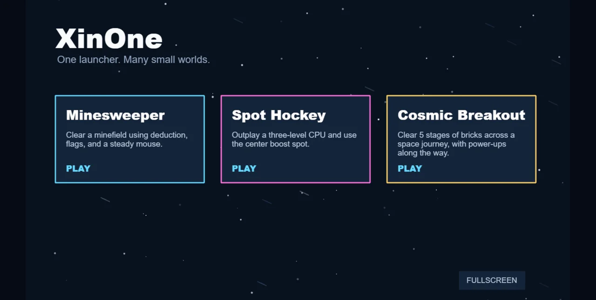
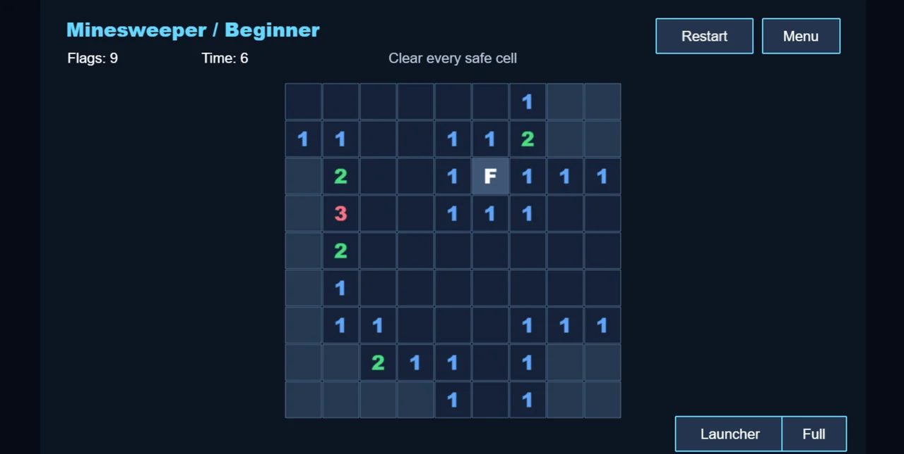
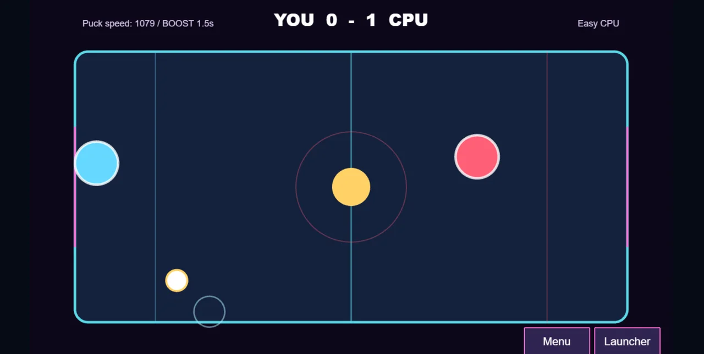
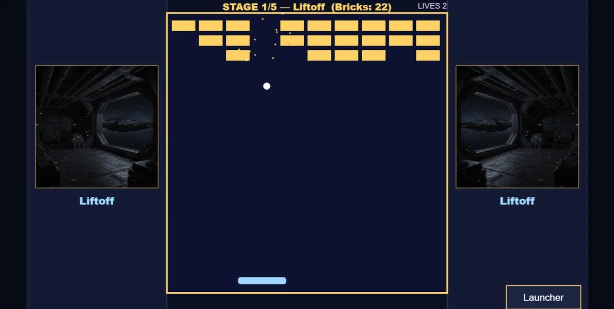

# XinOne

Phaser 3 と Tauri 2 で作られた、複数ゲーム対応のデスクトップゲームランチャーです。
現在は、難易度選択付きのマインスイーパー、Spot Hockey、Cosmic Breakout、Mecha Vanguard、Floor Hopperを収録しています。

**Web 版（ブラウザでプレイ）**: [https://kavao.github.io/XinOne/](https://kavao.github.io/XinOne/)

**Windows 版（デスクトップ）**: [Releases からダウンロード](https://github.com/kavao/XinOne/releases/latest)

## 収録ゲーム

### ランチャー



星空を背景に、収録ゲームをカードから選んで起動します。

### マインスイーパー



左クリックでセルを開き、右クリックで旗を立てて地雷原をクリアします。Beginner / Intermediate / Expert の3段階から選べます。

### Spot Hockey



マウスで左側のパドルを操作し、中央スポットでパックを加速させながら5点先取で勝利を目指します。CPU難易度は Easy / Normal / Hard です。

### Cosmic Breakout



全5ステージのブロック崩しです。ステージごとの宇宙船イラストと、マルチボール・パドル拡大・貫通・レーザーなどのアイテムが登場します。タイトルから各面を直接選べ、パドルのスワイプでスライス（次のブロック反射にスピンが乗る）を ON/OFF できます。

### Mecha Vanguard

全3面の縦スクロールメカシューティングです。マウス移動とオート連射、右クリックのボムで STAGE 1 軌道エレベーター、STAGE 2 採掘基地、STAGE 3 成層圏の防衛要塞を突破します。各面のクリア後は残機・スコア・強化を引き継ぎます。タイトルから面を選べ、GAME OVER 後は CONTINUE で現在面を再開できます。

STAGE 2ボス「坑道守護機」は、左右交互に開く装甲の橙色コアが弱点です。HPが半分になると背部砲塔と中央動力炉を展開し、赤白の高速ドリル弾を2連射します。ドリル弾は飛距離に応じて2倍まで拡大し、右側のアームからは自機方向に角度を散らした低速弾を撒きます。赤い破線はドリルの発射予告、紫色の弾は当たり判定のない見せ弾です。

STAGE 3には耐久の高いトビウオ型メカが登場し、予告後の急降下中にさらに加速します。最終ボス「蒼穹指揮機」は飛行形態ではフィールド全体を巡回しながら狙い撃ち3方向弾を3連射し、人型形態では画面上部から5方向へ速度差を付けた高速弾を3発ずつ放ちます。残りHPが1/3になると隙間のある高速弾幕を展開するので、緑色の通路を移動して回避します。3面ボス撃破で全クリアです。

### Floor Hopper

朝から夜明けまで流れる床を、二段ジャンプと落下中のマント滑空で渡る横スクロールです。コインを集めて残機を増やし、夜以降の加速を乗り越えて夜明けのあとクリアを目指します。

## 必要環境

- Node.js 20 以降
- npm 10 以降
- Rust と Cargo
- Tauri 2 が要求する OS 別のビルド依存関係

Windows では Microsoft C++ Build Tools と WebView2 が必要です。

## セットアップ

```powershell
npm install
```

## 起動

Tauri デスクトップアプリとして起動:

```powershell
npm run dev
```

Web ブラウザだけでフロントエンドを確認:

```powershell
npm run vite-dev
```

## 操作

- ランチャーのゲームカードをクリックするとゲームを開始します。
- マインスイーパーは左クリックでセルを開き、右クリックで旗を切り替えます。
- Spot Hockeyはマウス移動で左側の水色パドルを操作し、右側のCPUゴールを狙います。両パドルはゴール寄りのラインから開始し、中央スポットへパックを当てると2秒間だけ速度が倍になります。
- Spot HockeyはCPU難易度を3段階から選べます。先に5点取ると勝利です。
- Cosmic Breakoutはマウス移動でパドルを操作し、中央の正方形フィールドでブロックを崩します。全5ステージあり、4面ではアイテム（マルチボール・パドル拡大・貫通・レーザー）が出現します。壊れないブロックは20回当たるたびにその位置からアイテムを1つ落とします。タイトルの Start は1面から、STAGE SELECT で各面を直接選べます。SLICE は初期 ON で、パドルを振って当てると次のブロック反射にスピンが乗ります。
- Mecha Vanguardはマウス移動とオート連射、右クリックでボムです。タイトルの START は1面から通しプレイ、STAGE SELECT で STAGE 1 / STAGE 2 / STAGE 3 を直接選べます。GAME OVER 後は CONTINUE で現在面をスコア維持のまま再開できます。
- Floor Hopperはスペースまたはクリックでジャンプします。接地中と空中で1回ずつ、二段ジャンプできます。落下中にスペースを押し続けるとマントで滑空して落下を抑えられます（上昇中は効きません）。床の上に流れてくるコインは1枚100点で、10個ごとに残機が1つ増えます。残機は最初2人で、落ちたあとは数秒以内にスペースで再投入できます。速度は朝・昼・夕方など各30秒のあいだで遅いところから早くなり、次の時間帯でまた遅く戻って加速し直します。後半（夜以降）は遅い側でも前半より速く、夜明けが最速です。背景は朝→昼→夕方→夜→深夜→夜明けの順で、夜明けのあとクリアし、クリアボーナスは+5000点です。
- ゲーム中は画面右端の `II` ボタンでポーズし、`>` ボタンで再開します。ポーズ中はゲーム進行とBGMが停止します。
- `Launcher` ボタンでランチャーへ戻ります。
- Tauriデスクトップ版では、`Fullscreen` または `Full` ボタンでフルスクリーンを切り替えます。Web版にはフルスクリーンボタンを表示しません。

## テストと型検査

```powershell
npm test
npm run typecheck
```

## コンパイル

Web フロントエンドのみ:

```powershell
npm run vite-build
```

Tauri デスクトップアプリ:

```powershell
npm run build
```

Windows のインストーラーなどは、ビルド成功後に
`apps/desktop/src-tauri/target/release/bundle/` 以下へ生成されます。

## GitHub Pages（Web 版）

Web フロントエンドは GitHub Pages で公開できます。Tauri 版と同じゲーム内容をブラウザでプレイできます。

- 公開 URL: [https://kavao.github.io/XinOne/](https://kavao.github.io/XinOne/)
- `main` への push で [Deploy GitHub Pages](.github/workflows/pages.yml) ワークフローが自動デプロイします。
- 初回のみ、GitHub リポジトリの **Settings → Pages → Source** を **GitHub Actions** に設定してください。
- 設定後に workflow が 404 で失敗した場合は、Actions から **Re-run all jobs** で再実行してください。

詳細は [docs/github-pages.md](docs/github-pages.md) を参照してください。

## GitHub Releases（Windows 版）

Windows 向けインストーラー（`.exe` / `.msi`）は GitHub Releases で配布します。

- ダウンロード: [Releases（最新版）](https://github.com/kavao/XinOne/releases/latest)
- `v*` タグを push するか、Actions から [Release Windows](.github/workflows/release-windows.yml) ワークフローを手動実行するとビルド・公開されます。

詳細は [docs/github-release.md](docs/github-release.md) を参照してください。

## 構成

```text
apps/desktop             Tauri シェルとゲームランチャー
packages/game-contracts  ゲームが実装する共通契約
packages/game-runtime    起動、終了、ポーズ、フルスクリーンなどの共通処理
games/minesweeper        独立したマインスイーパーゲーム
games/hockey             独立したマウス操作ホッケーゲーム
games/breakout           独立したブロック崩しゲーム(全5ステージ)
games/mecha-shooter      独立した縦スクロールメカシューティング
games/floor-hopper       独立した横スクロールジャンプゲーム
```

ゲーム追加手順は [docs/adding-a-game.md](docs/adding-a-game.md) を参照してください。

次期ゲームの作業計画は [_workingspace/plan/mecha-scroll-shooter-plan.md](_workingspace/plan/mecha-scroll-shooter-plan.md) を参照してください。
