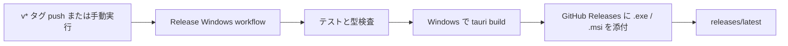

# GitHub Releases（Windows 版）

このガイドを読むと、XinOne の Windows 向けインストーラーを GitHub Releases で配布できます。

## ダウンロード URL

リポジトリ `kavao/XinOne` の場合、次の URL から最新版を取得できます。

[Releases（最新版）](https://github.com/kavao/XinOne/releases/latest)

配布物は次の2種類です。

- **`XinOne_<version>_x64-setup.exe`** — 一般向けインストーラー（NSIS）
- **`XinOne_<version>_x64_en-US.msi`** — MSI インストーラー

## 初回設定（リポジトリ管理者）

GitHub リポジトリの **Settings → Actions → General → Workflow permissions** を **Read and write permissions** に設定してください。Release 作成に write 権限が必要です。

## リリース手順

1. リリース対象の変更を `main` に push します。
2. バージョン番号を更新します。正本は `apps/desktop/src-tauri/tauri.conf.json` の `version` です。同じ値を次にも揃えてください。
   - `apps/desktop/src-tauri/Cargo.toml`
   - ルート `package.json`
   - `apps/desktop/package.json`
3. 次のいずれかで Release ワークフローを起動します。

### 方法 A（タグ） — 推奨

注釈付きタグ（`-a`）にメッセージ（`-m`）を付けて作成します。GitHub の Tags ページでもメッセージが表示されます。

1行メッセージの例:

```powershell
git tag -a v0.1.0 -m "XinOne 0.1.0 — 初回 Windows リリース"
git push origin v0.1.0
```

複数行メッセージの例:

```powershell
git tag -a v0.1.0 -m "XinOne 0.1.0

- マインスイーパー / Spot Hockey / Cosmic Breakout
- ゲーム中ポーズ対応
- Windows インストーラー配布開始"
git push origin v0.1.0
```

push 後、[Actions の Release Windows](https://github.com/kavao/XinOne/actions/workflows/release-windows.yml) が自動実行されます。

### 方法 B（手動実行）

Actions タブで **Release Windows** → **Run workflow** を実行します。draft として作成したい場合は **Create as draft release** にチェックを入れます。

## 自動ビルドの流れ



- ワークフロー定義: [.github/workflows/release-windows.yml](../.github/workflows/release-windows.yml)
- ローカルビルド成果物: `apps/desktop/src-tauri/target/release/bundle/`

## ローカルでインストーラーを確認する

CI を使わず手元でビルドする場合は、リポジトリルートで次を実行します。

```powershell
npm run build
```

成功すると `apps/desktop/src-tauri/target/release/bundle/` 以下に `.exe` と `.msi` が生成されます。

## 注意事項

- Release ワークフローは **Windows 向けのみ** ビルドします。Web 版の公開は [GitHub Pages 公開](github-pages.md) を参照してください。
- `main` への通常 push では Release は作成されません。`v*` タグ push または Actions からの手動実行でのみ起動します。
- タグ名（例: `v0.1.0`）と `tauri.conf.json` の `version`（例: `0.1.0`）は対応させてください。
